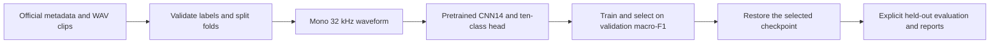

# Environmental Sound Recognition

A PyTorch project that classifies short recordings into ten UrbanSound8K sound
classes using an AudioSet-pretrained PANNs CNN14 model. It compares how much of
the pretrained network to fine-tune, selects a checkpoint on validation data,
and records the selected model's held-out performance.

**Recorded result:** 88.55% accuracy and 0.8964 macro-F1 on **test fold 1 only**
(873 clips). This is one seed and one held-out fold, with five source recording
IDs shared across official folds. It is not a ten-fold benchmark or a claim of
a new architecture. [Exact metrics](reports/faculty_evidence/heldout/evaluation_summary.json)
and [research interpretation](docs/RESEARCH.md) explain the evidence.

## Choose your starting point

| Your purpose | Start here | Next step |
|---|---|---|
| Inspect results without installing anything | `python -m src review` | [Notebook 02](notebooks/02_Stage4_Review_and_Stage5_HeldOut_Evaluation.ipynb) and [recorded reports](reports/faculty_evidence/) |
| Understand how the project works | [Project workflow](#project-workflow) below | [Notebook 01](notebooks/01_UrbanSound8K_PANNs_CNN14_Project.ipynb) walks through data and model stages |
| Set up the code and contribute | [Quick start](#quick-start) below | [Development guide](docs/DEVELOPMENT.md): modules, tests, common changes |
| Work with real audio, weights or training | [Reproducibility guide](docs/REPRODUCIBILITY.md) | Restore assets, check prerequisites, then start an explicit new run |
| Interpret experiments or compare papers | [Research guide](docs/RESEARCH.md) | Protocol, training settings, ablation, limitations and original references |
| Prepare the faculty submission | [Faculty instructions](docs/RESEARCH.md#faculty-submission) | [Notebook 03](notebooks/03_CO4_CO5_Faculty_Submission.ipynb) and `python -m src faculty audit` |

These are the project's four active guides: this README and the three files in
`docs/`. Experiment JSON/CSV/figures and the dated review under `reports/` are
evidence, separate from setup guidance.

## Quick start

Run commands **from the repository root**. Viewing committed results and CLI help
requires only Python; dataset WAVs, model weights and a GPU are unnecessary:

```powershell
python -m src --help
python -m src review
```

For development, use Python 3.13 and an isolated environment. In PowerShell:

```powershell
python -m venv .venv
.\.venv\Scripts\python.exe -m pip install -r requirements-cpu.txt
.\.venv\Scripts\python.exe -m src check --unit
.\.venv\Scripts\python.exe -m src check --environment
```

Select that interpreter in VS Code/Jupyter. On Linux, the environment interpreter
is `.venv/bin/python`. If your existing environment works, keep using it; the
remaining examples use `python` for the selected interpreter.

Use `requirements.txt` instead for the original CUDA 12.8 training build
(PyTorch 2.7.0+cu128, verified on Windows/RTX 3050). Both recipes use the same
unchanged dependency ranges in `requirements-common.txt`. The CPU-wheel recipe
has not been freshly installed as part of this cleanup. The historical
`requirements.lock.txt` records direct package versions, not a complete transitive
or hash-verified lock. [Environment details](docs/REPRODUCIBILITY.md#environment).

## Project workflow



1. **Validate data.** UrbanSound8K supplies 8,732 clips, ten class IDs and ten
   predefined folds. Keep those labels and fold assignments.
2. **Prepare model input.** Average audio channels to mono, resample to 32 kHz,
   then center-crop or right-pad to 128,000 float32 samples (four seconds).
   CNN14 computes its own log-Mel features; spectrogram illustrations are not
   precomputed inputs to the classifier.
3. **Adapt the model.** The original 527-class AudioSet network supplies a
   2,048-feature embedding. A new linear head produces ten raw scores (logits)
   for cross-entropy loss. Modes `head`, `fc1` and `block6` progressively unfreeze
   the classifier, final dense layer and final convolution block. Pretrained
   BatchNorm running statistics remain fixed.
4. **Train and select.** For the recorded experiment, folds 3-10 train the model,
   fold 2 selects freezing depth and the best checkpoint, and fold 1 stays held
   out. Checkpoint selection maximizes validation macro-F1 (the average F1 across
   all classes), with accuracy as tie-break.
5. **Restore before evaluating.** `best.pt` stores only trainable parameters.
   Reconstruct the pinned original backbone first, then apply those parameters.
   It is not a complete standalone CNN14 checkpoint.
6. **Evaluate deliberately.** Only the validation-selected `block6` model has a
   recorded test result. The evaluator checks run/checkpoint agreement and
   guards against accidental repeated evaluation. Use saved reports for review;
   held-out results are not a tuning signal.

## Commands by task

All commands support `--help`; help stays lightweight and does not load PyTorch.

| Command | What it does | Required resources |
|---|---|---|
| `python -m src review` | Reads recorded held-out metrics | Committed reports; standard library only |
| `python -m src check --unit` | Runs offline synthetic-data/toy-model tests | Installed dependencies |
| `python -m src check --environment` | Checks imports and optional GPU computation | Installed dependencies |
| `python -m src check --environment --require-cuda` | Requires a working CUDA GPU | CUDA environment |
| `python -m src audit-data` | Checks metadata and all referenced WAV paths | Dataset; no audio decoding |
| `python -m src audit-folds` | Reports official partitions and source overlap | Dataset metadata |
| `python -m src audit-audio --max-files 50` | Decodes a diagnostic sample | Dataset; isolated pilot outputs |
| `python -m src check-loader` | Checks train/validation batch shapes | Dataset |
| `python -m src check-model --use-safe-weights --cpu` | Strict-loads and checks the original model | Pinned source and restricted-loadable backbone weights |
| `python -m src check-gradients --config head` | Verifies a training-only backward/update step | Dataset, source and backbone weights |
| `python -m src train --config head --epochs 6 --patience 2` | Creates a new training run | Dataset, source and backbone weights |
| `python -m src evaluate --run-dir <selected-run>` | Evaluates an explicitly selected completed run | Selected run and external assets |
| `python -m src snapshot-env --out <file>` | Explicitly records direct dependency versions | Installed dependencies |
| `python -m src faculty audit` | Audits submission evidence | Committed project files/reports |
| `python -m src faculty package --help` | Explains deliberate archive creation | Actual identity and exact selected weights when executed |

Applicable model commands accept `--dataset-root`, `--weights` and
`--pann-source`. All relative CLI paths resolve against this checkout.
`audit-folds --metadata <path>` accepts a CSV directly. Dataset and checkpoint
acquisition, checksum verification and trusted legacy conversion are described
once in [reproducibility](docs/REPRODUCIBILITY.md).

Training defaults remain three epochs and patience three. The recorded comparison
used explicit `--epochs 6 --patience 2`, seed 67, batch size one and accumulation
four. A small loop diagnostic can use `--max-train-batches 4 --max-val-batches 4`;
it is marked `diagnostic_only` and cannot serve as final research performance.

The old root scripts and stage runners have been consolidated into this CLI.
[Command replacements](docs/DEVELOPMENT.md#command-replacements) cover existing
local workflows. There is no automatic dependency installation or full training
in the lightweight check command.

## Repository and output map

```text
README.md                      Start here; purpose-based navigation
src/                           All application Python code and the CLI
notebooks/                     Three explanatory notebooks with saved outputs
tests/                         Offline tests and workflow regressions
docs/                          DEVELOPMENT, REPRODUCIBILITY and RESEARCH guides
reports/                       Committed historical metrics, CSVs and figures
figures/                       Historical dataset illustrations
data/UrbanSound8K/              External official metadata and audio (local)
checkpoints/                    Original and restricted-loadable backbone weights (local)
results/                        New local runs, audits, logs and predictions
external/audioset_tagging_cnn/   Pinned upstream source submodule
```

A training invocation creates
`results/stage4/<timestamp>_<config>_test<fold>/` with `config.json`, `history.csv`,
`learning_curves.png`, `best.pt` and `summary.json`. Evaluation writes aggregate
and per-class metrics, per-file probabilities and plots under `results/stage5/`.
Partial audio scans use `results/audio_audits/pilot_<timestamp>/` and a matching
figure directory, so they cannot replace the full audit. Some early `results/`
reports are already tracked; `.gitignore` does not change that history.

Recorded evidence under `reports/` is not proof of a new execution on your
machine. A timestamp is not scientific model selection: review uses the recorded
checkpoint identity, and local run/evaluation selection must be explicit.

## Where to edit next

| Intended change | Start with | Read/check next |
|---|---|---|
| Dataset validation or fold audit | [src/metadata.py](src/metadata.py) | Official labels, file keys and source overlap tests |
| Waveform preprocessing or batches | [src/dataset.py](src/dataset.py) | Synthetic WAV and fold tests |
| Defaults, class names or asset paths | [src/config.py](src/config.py) | CLI and notebook path-override tests |
| Backbone loading or original-weight conversion | [src/pann_adapter.py](src/pann_adapter.py), [src/diagnostics.py](src/diagnostics.py) | Strict loading, source pin and integration checks |
| Which layers train or optimizer groups | [src/finetune_model.py](src/finetune_model.py) | Freeze, BatchNorm and trainable-checkpoint tests |
| Training loop or checkpoint selection | [src/finetune_train.py](src/finetune_train.py) | Accumulation, gradient and validation-selection tests |
| Precision or numerical checks | [src/runtime.py](src/runtime.py) | BF16/FP32 and nonfinite-output tests |
| Evaluation metrics or report outputs | [src/evaluate_selected.py](src/evaluate_selected.py) | Known-probability/confusion-matrix tests |
| Command arguments | [src/arguments.py](src/arguments.py), [src/__main__.py](src/__main__.py) | CLI help and dispatch tests |
| Notebook display or execution controls | [src/notebook_helpers.py](src/notebook_helpers.py) | Default review must remain free of model/data actions |
| Faculty archive contents | [src/submission.py](src/submission.py) | Tiny synthetic archive and provenance tests |

Make one focused change, run the relevant tests, then `python -m src check --unit`.
The [development guide](docs/DEVELOPMENT.md) explains responsibilities, common
extension points, validation and terminology. New preprocessing/model/protocol
changes should produce new experiment evidence; keep existing reports intact.

## Notebooks and next investigations

- [01 - Data and model workflow](notebooks/01_UrbanSound8K_PANNs_CNN14_Project.ipynb):
  preprocessing, folds, model adaptation and explicit local actions. It starts
  with `REVIEW_ONLY=True`.
- [02 - Experiments and held-out results](notebooks/02_Stage4_Review_and_Stage5_HeldOut_Evaluation.ipynb):
  the three recorded runs, validation selection and saved test evidence.
- [03 - Research and faculty submission](notebooks/03_CO4_CO5_Faculty_Submission.ipynb):
  interpretation, paper comparisons and optional audit/packaging.

Default notebook review reads reports and figures. Training, inference, README
updates and archive creation stay disabled until explicitly enabled. Saved
outputs are historical; long action logs are collapsed.

There is currently no standalone `predict <wav>` command or hosted application.
To add prediction for your own recordings, reuse `dataset.read_waveform`, restore
the backbone and selected parameters through `finetune_model`, and apply the
official class mapping from `config.py`. Keep that feature separate from the
dataset's held-out evaluation workflow.

For further research, the useful next steps are prescribed ten-fold evaluation,
multiple seeds and controlled comparisons of smaller unfreezing depths. Those
experiments are not yet completed. Preserve the existing test result's scope;
see [research limitations](docs/RESEARCH.md#freezing-depth-study) before designing
a new study or comparing published accuracies.

## Sources and attribution

[UrbanSound8K](https://urbansounddataset.weebly.com/urbansound8k.html) supplies the
audio and official folds. [PANNs](https://github.com/qiuqiangkong/audioset_tagging_cnn)
supplies the MIT-licensed CNN14 implementation, pinned to
`d2f4b8c18eab44737fcc0de1248ae21eb43f6aa4`. Original AudioSet weights are from
[Zenodo](https://zenodo.org/records/3576403). Respect upstream and dataset terms;
keep their source attribution separate from project-created results.

<!-- FACULTY_EVIDENCE_START -->
Measured [held-out metrics](reports/faculty_evidence/heldout/evaluation_summary.json),
[research context and ablation](docs/RESEARCH.md), and
[faculty requirements](docs/RESEARCH.md#faculty-submission) document the submission.
<!-- FACULTY_EVIDENCE_END -->
